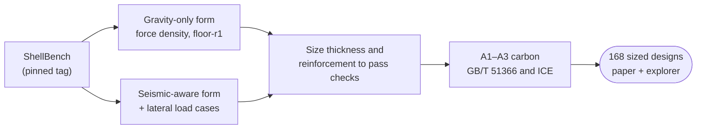

# ShellForm

[](https://github.com/syednafizreja/Shellform/actions/workflows/tests.yml)


**The carbon cost of seismic resilience: gravity-only versus seismic-aware form-finding of concrete shells.**

How much embodied carbon does seismic resilience cost in a form-found concrete shell, and does form-finding that includes seismic loads deliver it more cheaply than thickening a gravity-only shape?

ShellForm extends the seismic form-finding of Michiels & Adriaenssens (2017, 2018). It sizes each form to pass code checks and counts its A1–A3 embodied carbon. It is built on the validated, tagged modules of [ShellBench](https://github.com/syednafizreja/ShellBench) and never copies a ShellBench value (see [docs/data_contract.md](docs/data_contract.md)).

> **Status.** Day 0 (28 Oct 2026): repository, environment and CI are set up. The pre-registration is a draft awaiting the author's approval. Form-finding waits for ShellBench `floor-r1`. Daily progress is in [LOG.md](LOG.md).

---

## Approach

Both strategies use the same checks, materials, sizing rule and carbon factors. Only the form differs.



## Design space

| Variable | Levels |
|---|---|
| Plan | Square |
| Span | 10 m, 20 m |
| Supports | 4 corner supports; continuous edge supports |
| Rise-to-span | 0.10, 0.15 (baseline), 0.20 |
| Strategy | gravity-only; seismic-aware |
| Plateau spectral acceleration Sa | 0, 0.1, 0.2, 0.3, 0.4, 0.5, 0.6 g |

2 × 2 × 3 × 2 × 7 = 168 sized designs. Checks, decision rules and validation tests S1–S5 are fixed in [docs/preregistration.md](docs/preregistration.md) before any run.

## Progress

| Item | Where | Status |
|---|---|---|
| Pre-registration | [docs/preregistration.md](docs/preregistration.md) | Draft, awaiting author approval |
| Seismic-aware form-finding | [src/shellform/](src/shellform/) | Waits for ShellBench `floor-r1` |
| Validation tests S1–S5 | [tests/](tests/) | Not started (smoke tests pass) |
| 168 sized designs | [results/](results/) | Not started |
| Design explorer | [explorer/index.html](explorer/index.html) | Skeleton, dummy data |
| Manuscript | [paper/](paper/) | Not started |

## Repository layout

| Path | Contents |
|---|---|
| [src/shellform/](src/shellform/) | The package. [pin.py](src/shellform/pin.py) holds the ShellBench tag. |
| [tests/](tests/) | pytest suite, run by CI on every push and pull request |
| [docs/](docs/) | [Data contract](docs/data_contract.md), [pre-registration](docs/preregistration.md), [handoff](docs/handoff.md) between work sessions |
| [data/](data/) | ShellForm-only inputs. ShellBench data is read in place, never copied. |
| [results/](results/) | Script output only. Every file names the ShellBench tag it used. |
| [figures/](figures/) | Regenerated from `results/` by script, never edited by hand |
| [explorer/](explorer/) | Browser design explorer (three.js) |
| [notes/](notes/) | Reading notes |
| [paper/](paper/) | Manuscript |
| [LOG.md](LOG.md) | Daily log: done, result, problem, lesson, tomorrow |

## Reproducibility rules

1. **One home for every value.** Carbon factors, code values and load data come from ShellBench at the pinned tag, by import or by reading its files in place. Unconfirmed values are marked [?].
2. **Pinned dependency.** ShellBench is installed from a separate read-only clone checked out at `SHELLBENCH_TAG` in [pin.py](src/shellform/pin.py). A smoke test fails if the installed version differs.
3. **Pre-registered analysis.** Checks, thresholds and decision rules are committed before any run. Later changes go in a dated amendment that says why.
4. **Traceable results.** Every number in `results/` traces to a ShellBench tag, a code clause, a paper or this repo's code.

## Setup

ShellForm uses its own conda environment, `shellform` (a clone of ShellBench's `research` plus meshio; versions in [environment.yml](environment.yml)), and a second, read-only clone of ShellBench checked out at the pinned tag. Daily ShellBench work never changes ShellForm's inputs, and ShellForm never changes ShellBench's environment.

```powershell
$conda = "C:\Users\ASUS\miniconda3\Scripts\conda.exe"
cd C:\Users\ASUS
git clone https://github.com/syednafizreja/ShellBench.git ShellBench-pin
cd ShellBench-pin; git checkout v0.0.1          # the tag in src/shellform/pin.py
& $conda env create -f C:\Users\ASUS\ShellForm\environment.yml
& $conda run -n shellform pip install -e C:\Users\ASUS\ShellBench-pin --no-deps
cd C:\Users\ASUS\ShellForm
& $conda run -n shellform pip install -e . --no-deps
& $conda run -n shellform pytest
```

**Moving the pin:** `cd C:\Users\ASUS\ShellBench-pin; git fetch --tags; git checkout <new tag>`, update `src/shellform/pin.py` and the pin badge above, run `pytest`, and note the move in LOG.md.

## Continuous integration

[tests.yml](.github/workflows/tests.yml) runs `pytest` on Python 3.12 for every push to `main` and every pull request. It reads the tag from `pin.py` and checks out ShellBench at that tag using a read-only deploy key (secret `SHELLBENCH_DEPLOY_KEY`). [release.yml](.github/workflows/release.yml) publishes a GitHub release when `docs/releases/v<version>.md` reaches `main` with a new version in `pyproject.toml`.

## Citation and licence

MIT licence. Cite with [CITATION.cff](CITATION.cff).
